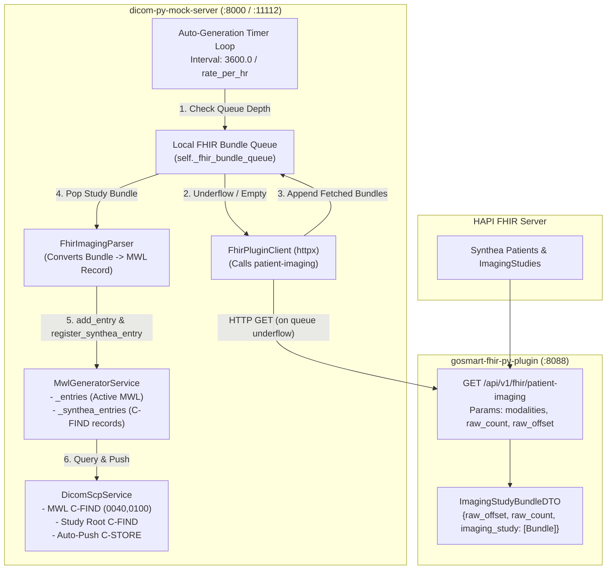

# Implementation Plan: FHIR-Driven Modality Worklist (MWL) & C-FIND Generation

## 1. Executive Summary & Core Premise
This plan specifies the implementation of FHIR-driven Modality Worklist (MWL) and DICOM C-FIND entry generation in `dicom-py-mock-server` using the peer `gosmart-fhir-py-plugin` service.

### Core Premise & Operational Rules
- **Generation Rate**: Exactly `GOSMART_MS_MWL_RATE_PER_HR` (scaled by business hours vs. off-hours) new MWL and C-FIND entries are generated per hour.
- **Queue-Driven Ingestion**:
  1. Maintain an in-memory queue of FHIR `Bundle` objects (`self._fhir_bundle_queue`).
  2. On each wake-up cycle, if the queue is empty or does not contain enough items for the cycle, fetch the next batch from the `gosmart-fhir-py-plugin` `/api/v1/fhir/patient-imaging` endpoint using `raw_offset` and `raw_count`.
  3. Studies are generated strictly up to the rate defined by `GOSMART_MS_MWL_RATE_PER_HR`.
  4. Upon data exhaustion from the API (API returns 0 bundles and queue is empty), the generator halts further generation, cleanly idling without generating synthetic patients.
  5. The status of number of items returned, raw count, raw offset, and exhaustion state are explicitly logged.

---

## 2. Architecture & Data Flow



---

## 3. Pacing & Queue Algorithm Specification

### Mathematical Pacing
- `rate_per_hr = mwl_service.get_current_rate_per_hr(now)`:
  - Business hours (9 AM - 5 PM local): `mwl_rate_per_hr` (default 12.0/hr).
  - Off-hours: `mwl_rate_per_hr * 0.05` (default 0.6/hr).
- Cycle Interval:
  $$\text{interval\_sec} = \frac{3600.0}{\max(\text{rate\_per\_hr}, 0.01)}$$
  *(e.g., at 12/hr, interval is exactly 300.0 seconds / 5 minutes).*

### Step-by-Step Loop Algorithm
```python
while self._is_auto_generating:
    now = datetime.now()
    rate_per_hr = self.get_current_rate_per_hr(now)
    interval = 3600.0 / max(rate_per_hr, 0.01)

    # 1. Check if local queue has items for this wake-up cycle
    items_needed = 1  # 1 study per interval ticks
    if len(self._fhir_bundle_queue) < items_needed:
        # 2. Fetch more from patient-imaging API
        fetched_bundles, new_offset, raw_count = await self._fetch_fhir_bundles(
            offset=self._fhir_raw_offset,
            count=self.config.fhir_raw_count,
        )
        logger.info(
            "fhir_patient_imaging_fetched",
            items_returned=len(fetched_bundles),
            raw_count=raw_count,
            raw_offset=new_offset,
            queue_depth_before=len(self._fhir_bundle_queue),
        )
        self._fhir_raw_offset = new_offset
        self._fhir_bundle_queue.extend(fetched_bundles)

    # 3. Check for Data Exhaustion
    if not self._fhir_bundle_queue:
        logger.warning(
            "fhir_patient_imaging_exhausted",
            raw_offset=self._fhir_raw_offset,
            message="No FHIR imaging studies available from patient-imaging API; generation paused.",
        )
    else:
        # 4. Generate the study from the next queued bundle
        study_bundle = self._fhir_bundle_queue.pop(0)
        entry_records = self._parser.parse_bundle_to_mwl_records(study_bundle)
        for entry_record in entry_records:
            # Add to active MWL and C-FIND indices
            self._entries.append(entry_record)
            self.register_synthea_entry(entry_record)
            
            # Forward to auto-push queue if auto-push is active
            if self._scp_service and self.config.auto_push_ae:
                self._scp_service.enqueue_auto_push_study(entry_record)

            logger.info(
                "fhir_mwl_entry_activated",
                patient_id=entry_record["patient_id"],
                study_uid=entry_record["study_uid"],
                accession=entry_record["accession"],
                modality=entry_record["modality"],
                queue_depth_remaining=len(self._fhir_bundle_queue),
            )

    # 5. Sleep responsive interval before next generation
    await self._interruptible_sleep(interval)
```

---

## 4. Gap Analysis & Resolution Matrix

| Gap # | Area | Observed Gap / Issue | Resolution |
| :--- | :--- | :--- | :--- |
| **GAP-1** | **API Endpoint Path** | `request.md` lists `Call /api/v1/patient-imaging`. In `gosmart-fhir-py-plugin`, the router prefix is `/api/v1/fhir`, so the actual endpoint is `/api/v1/fhir/patient-imaging`. | Client calls `GET {fhir_plugin_url}/api/v1/fhir/patient-imaging`, falling back to `/api/v1/patient-imaging` if 404. |
| **GAP-2** | **Env Var Naming Typo** | `request.md` introduces `GOSMART_MS_WML_GENERATOR_MODE` (transposed `WML` instead of `MWL`). | Support both `GOSMART_MS_WML_GENERATOR_MODE` and `GOSMART_MS_MWL_GENERATOR_MODE` as aliases in `AppConfig`, plus `GENERATOR_MODE`. |
| **GAP-3** | **Runtime Dependency** | `httpx` is in `[dependency-groups] dev` in `pyproject.toml`. In production runtime, calling the external plugin requires `httpx`. | Add `httpx>=0.27.0` to `[project.dependencies]` in `pyproject.toml`. |
| **GAP-4** | **Initial Seeding in FHIR Mode** | In `main.py`, startup runs `mwl_service.seed_initial_entries(count=10)` which synthesizes random dummy patients. | In `fhir` mode, skip synthetic seeding. Instead, immediately run initial queue population and activate the first study on startup. |
| **GAP-5** | **Batch Spikes vs Hourly Pacing** | Ingesting all 200 items in one timer tick violates `GOSMART_MS_MWL_RATE_PER_HR`. | Local queue buffers batches; the timer loop consumes exactly 1 study per `3600.0 / rate_per_hr` interval. |
| **GAP-6** | **Auto-Push Synthetic Leakage** | `DicomScpService._push_one_auto_study()` falls back to synthetic generation when its auto-push queue is empty. | In `fhir` mode, auto-push only dequeues studies that originated from the FHIR ingestion queue; if empty, it idles without creating synthetic patients. |
| **GAP-7** | **Bundle Parsing Differences** | The returned DTO packages `Patient` and `ImagingStudy` (no hospital/practitioner bundles). | Cleanly extract patient demographics and study/series metadata, strip `urn:oid:` and `urn:uuid:` prefixes, and fallback to `config.institution_name` and physician pools. |
| **GAP-8** | **Plugin Fault Tolerance** | If the plugin is temporarily unreachable (network timeout / 500 error), mock server loop must not crash. | Catch `httpx.HTTPError`, log structured error, retain `raw_offset` without advancement, and retry after backoff. |
| **GAP-9** | **Exhaustion Handling** | When all HAPI FHIR records have been processed, the API returns an empty `imaging_study` list and `raw_count=0`. | Persist `raw_offset`, log exhaustion warning, and idle gracefully without generating new studies until more data is available. |
| **GAP-10**| **Observability** | Need runtime visibility into FHIR sync status (`raw_offset`, queue depth, last fetch). | Expose `generator_mode`, `fhir_plugin_url`, `fhir_raw_offset`, `fhir_queue_depth`, and `is_exhausted` in `/api/v1/mwl/status`. |

---

## 5. Detailed Implementation Tasks

### Task 1: Dependencies & Configuration
- **File**: [`pyproject.toml`](file:///Users/manabutokunaga/development/dicom-fhir/dicom-py-mock-server/pyproject.toml)
  - Add `httpx>=0.27.0` to `[project.dependencies]`.
- **File**: [`src/dicom_py_mock_server/config.py`](file:///Users/manabutokunaga/development/dicom-fhir/dicom-py-mock-server/src/dicom_py_mock_server/config.py)
  - `fhir_plugin_url: str = Field(default="http://localhost:8088", validation_alias=AliasChoices("GOSMART_MS_FHIR_PLUGIN_URL", "FHIR_PLUGIN_URL"))`
  - `generator_mode: str = Field(default="internal", validation_alias=AliasChoices("GOSMART_MS_WML_GENERATOR_MODE", "GOSMART_MS_MWL_GENERATOR_MODE", "GENERATOR_MODE", "WML_GENERATOR_MODE"))`
  - `fhir_raw_count: int = Field(default=200, validation_alias=AliasChoices("GOSMART_MS_FHIR_RAW_COUNT", "FHIR_RAW_COUNT"))`

### Task 2: FHIR Imaging Parser Service
- **File**: [`src/dicom_py_mock_server/services/fhir_parser.py`](file:///Users/manabutokunaga/development/dicom-fhir/dicom-py-mock-server/src/dicom_py_mock_server/services/fhir_parser.py) (or `fhir_imaging_parser.py`)
  - Parse bundle containing `Patient` and `ImagingStudy`.
  - Extract Patient: ID, Name (with `patient_suffix`), DOB, Sex.
  - Extract Study: clean `StudyInstanceUID`, Accession, Date, Time, Description.
  - Extract Series: clean `SeriesInstanceUID`, Series Number, Modality, Series Description, Number of Instances.
  - Return standardized dictionary representation compatible with `mwl_service.build_study_series_record`.

### Task 3: Ingestion Client & Queue Loop in MWL Generator
- **File**: [`src/dicom_py_mock_server/services/mwl_generator.py`](file:///Users/manabutokunaga/development/dicom-fhir/dicom-py-mock-server/src/dicom_py_mock_server/services/mwl_generator.py)
  - Add state variables:
    - `self._fhir_bundle_queue: list[Any] = []`
    - `self._fhir_raw_offset: int = 0`
    - `self._fhir_is_exhausted: bool = False`
  - Implement `_fetch_fhir_bundles(raw_offset: int, raw_count: int) -> tuple[list[Any], int, int]`.
  - Update `_auto_generation_loop()`:
    - If `generator_mode == "fhir"`: run the queue-checking, API replenishment, hourly pacing, and exhaustion-handling algorithm.
    - If `generator_mode == "internal"`: keep standard internal synthesis.
  - Update `get_status()` to report FHIR queue metrics and status.

### Task 4: Lifespan Startup & Auto-Push Safety
- **File**: [`src/dicom_py_mock_server/main.py`](file:///Users/manabutokunaga/development/dicom-fhir/dicom-py-mock-server/src/dicom_py_mock_server/main.py)
  - In `lifespan`: If `config.generator_mode == "fhir"`, skip synthetic `seed_initial_entries(count=10)`. Trigger the auto-generation loop to immediately perform its first fetch & initial activation.
- **File**: [`src/dicom_py_mock_server/services/scp.py`](file:///Users/manabutokunaga/development/dicom-fhir/dicom-py-mock-server/src/dicom_py_mock_server/services/scp.py)
  - In `_push_one_auto_study`: If `config.generator_mode == "fhir"`, do not call `mwl_service.add_entry()` when queue is empty; log idle status and return `None`.

---

## 6. Verification & Testing Plan

### Automated Test Suite
1. **Config & Alias Verification** (`tests/test_config.py`):
   - Test default values and aliases (`GOSMART_MS_WML_GENERATOR_MODE`, `GOSMART_MS_FHIR_PLUGIN_URL`).
2. **Parser Unit Tests** (`tests/test_fhir_imaging_generator.py`):
   - Test parsing bundle with `Patient` and `ImagingStudy` resources.
   - Verify proper UID stripping (`urn:oid:`), accession handling, date formatting, and modality validation.
3. **Queue & Replenishment Integration Tests** (`tests/test_fhir_imaging_generator.py`):
   - Mock `/patient-imaging` endpoint via `httpx` mock transport.
   - Test queue replenishment when queue is empty or has insufficient items.
   - Verify `raw_offset` increases monotonically with returned `raw_offset`.
   - Test exhaustion: API returns 0 items -> generator logs exhaustion and stops creating entries.
   - Test error recovery: API returns 500 or network timeout -> generator handles error gracefully without terminating.
4. **C-FIND & DICOMweb Integration Tests**:
   - Verify MWL C-FIND (0040,0100) queries discover FHIR-generated studies.
   - Verify Study Root C-FIND (Study, Series, Image levels) discovers FHIR-generated studies.
   - Verify DICOMweb QIDO-RS returns the FHIR-generated studies.
5. **Full Regression Suite**:
   - Run `uv run pytest` across all tests (197 existing tests + new tests) to ensure 100% pass rate.

### Live Environment Testing (with Running Plugin)
1. Verify endpoint connectivity against live `http://localhost:8088/api/v1/fhir/patient-imaging`.
2. Inspect log output for:
   - `fhir_patient_imaging_fetched`
   - `fhir_mwl_entry_activated`
   - `fhir_patient_imaging_exhausted`
3. Execute DICOM MWL query (`findscu`) to verify real-time queryability.
